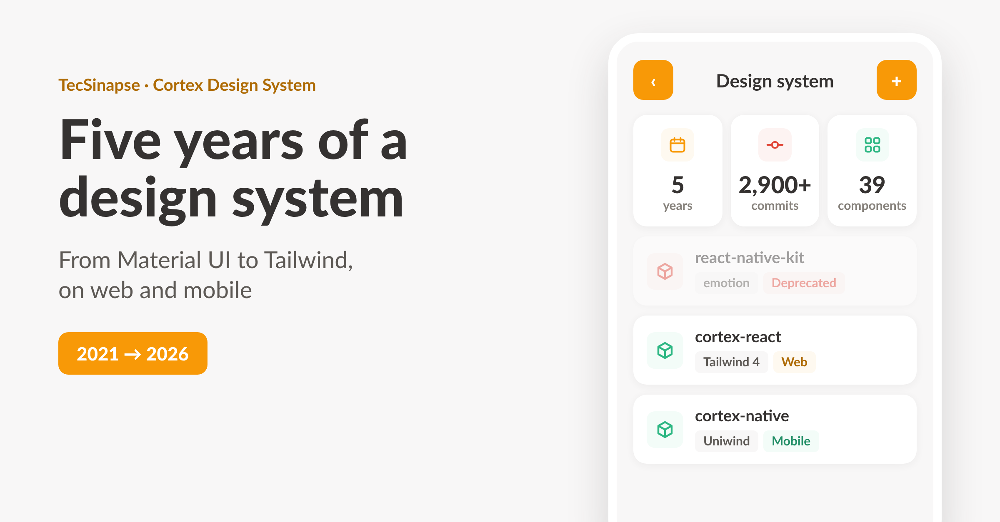

## Why tell this story

Five years ago, our team at TecSinapse started building a design system of our own. Today it runs on Tailwind on the web and in React Native. Getting here took us through emotion, React Native Web, a system with no name, two generations of packages and, most recently, coding agents.

It’s the work I’m proudest of at the company and the main case in my portfolio. Not because every decision was right: I’d question some of them today. But each one was the best our team could make with what we knew at the time, and that’s what this article tries to show.

The facts come from the history of the [repository, which is public](https://github.com/tecsinapse/design-system): more than 2,900 commits since March 2021.

## 2020: an outdated Material UI and a native app on the horizon

The conversations started a few months before the first commit, between late 2020 and early 2021. Until then, the company’s interfaces ran on ui-kit, a library built on Material UI that started on v3 and made it to v4.

Material UI was already heading to v5, and we were falling behind. On top of being heavy, it tied us to an outside vendor in the one place that is most ours: how our products look. We wanted our own identity.

There was one more reason. A native app was being proposed, so the new design system had to serve web and mobile from day one.

ui-kit still exists alongside the new system, but it’s being deprecated and almost nothing new is built with it.

## 2021: Figma, a customized kit and emotion on both platforms

It was a collective effort. Two teams were involved, marketing and mine, with developers and UX and UI folks. It was also when the company adopted Figma.

Instead of designing everything from scratch, we started from an off-the-shelf kit, which the designer at the time customized to our identity: components, variants and example screens. That Figma library became the reference for the implementation.

In code, the central decision was how to write styles. We wanted something hybrid that ran the same way on the web and in React Native. Styled-components and emotion were at their peak, and emotion let you write styles as CSS, even on native.

That produced the first architecture, in April 2021:

- **react-core**, with the shared foundation;
- **react-web-kit**, for the web;
- **react-native-kit**, for mobile.

All of them used emotion. On the web, components ran on top of React Native Web, so the same foundation could serve both platforms.

You could argue we’d have done better with React Native’s StyleSheet on mobile and plain CSS on the web. But unifying looked like the right path, and for that moment I think it was.

## The cost of a single layer

The system worked well for quite a while. In 2023 it got a playground for testing mobile components. But signs of wear started to show.

The biggest one was React Native Web. On the web we weren’t rendering HTML: we were rendering React Native views that went through an adaptation layer. Every behavior or styling detail outside the happy path turned into a fight with that layer.

At the same time, the styled-components model was falling out of favor, our emotion version had been outdated for a long time, and the library was heavy. We wanted to modernize the codebase.

And there was a telling detail: the system didn’t even have a name. It was react-core, web-kit and native-kit. To everyone, it was just “the design system”.


## 2023–2024: Cortex, Tailwind and real HTML

Modernization started on the web, and it came with a name: Cortex. In November 2023, the team created cortex-core, with the Tailwind setup and the first components. In June 2024 came cortex-react, with the React primitives. Cortex became the official web package.

Why Tailwind? The first reason was going back to the native web: leaving React Native Web and using real HTML elements, with no adaptation layer.

The second was speed. Our teams are lean, and we needed a short learning curve. Tailwind isn’t exactly writing CSS, but it’s very fast for prototyping, while emotion and styled components ask a lot more of newcomers. And Tailwind was already mature.

To give components structure, we used tailwind-variants, in the spirit of CVA (class-variance-authority): a base, variants, compound combinations, and tailwind-merge to resolve class conflicts. The badge in cortex-core shows the shape, trimmed down:

```
const badgeStyles = tv({
  base: 'text-sub text-white font-bold rounded-pill',
  variants: {
    intent: {
      primary: 'bg-primary-medium',
      error: 'bg-error-medium',
      success: 'bg-success-medium',
    },
    isAnchor: {
      true: 'absolute -top-1 -right-1',
    },
  },
  defaultVariants: { intent: 'primary' },
});
```

Styling stopped being runtime code and became a readable decision table. It got lighter and far more practical.

It became the standard almost overnight. New applications were born on Cortex, and the old ones that were easy to migrate got migrated.

## Keeping the foundation alive

A design system doesn’t only age in its components. It ages in the tooling around them too, and a good share of the work in recent years was that upkeep:

- **August 2024:** the monorepo moved from Lerna to Lerna Lite, to use pnpm’s `workspace:` protocol and stop pinning internal versions.
- **January to May 2026:** the team moved the web to Tailwind 4, together with React 19. It was a big change and took real work.
- **August 2026:** tests moved from Jest to Vitest, the build moved from Rollup to Rolldown, and dependency versions moved into a single pnpm catalog.

That’s also when AI joined the workflow. The repo got an AGENTS.md at the root and one per package, explaining how each part works, plus skills to help the team with recurring tasks such as upgrading Expo.

Each of these steps has its own short post. Here, what matters is the pattern that keeps repeating: a spec before code, an explicit contract and small changes.

## 2026: Cortex Native, Uniwind and a migration in days

Mobile was still missing. react-native-kit still used emotion, and it was bloated and heavy on native. I’d wanted to retire it for a long time.

More than a year earlier, I’d been looking at ways to use Tailwind in React Native, mostly NativeWind. The catch: the web was moving to Tailwind 4, and I didn’t want to build native on an older version. When I evaluated it, NativeWind didn’t have a stable release for Tailwind 4 yet.

Then I found Uniwind, which supports Tailwind 4 and describes itself as faster than NativeWind. I built prototypes and examples, and it worked really well. I decided to adopt it.

The migration followed a script:

1. **August 7:** I wrote the spec and the migration plan together with my coding agent.
2. **August 18 and 19:** agents ported 39 components, using react-native-kit as the reference.
3. **August 19:** react-core and react-native-kit were marked as deprecated, and the old react-web-kit was removed from the repo.

In practice, it took two to three days of migration to replace a library built over five years.

Two things came as a bonus. The first was dark mode: the design system never had it, and with Uniwind it became possible. The second was a migration skill. I had to move the playground from native-kit to Cortex Native, turned the process into a skill, and have already used it to migrate an app. It was quick and easy.

In early September, I implemented the pattern we use today: composition. Components now accept `className` and are assembled from parts, such as Card, Input, Button and Snackbar. All of it shipped on October 28, in a 568-file merge.

The result, as I see it, is a faster system that looks more polished.

## What five years taught me

**Decisions have an expiration date.** Emotion with React Native Web was the right call in 2021 and became a burden by 2023. Both are true, and that’s fine.

**Unifying costs more than it looks.** A single layer for web and mobile looked like savings. In practice, the web paid for it by losing access to real HTML. Today what ties the platforms together is cortex-core, with shared tokens and variants, and each platform renders in its own way.

**Naming changes the project.** While it was “the design system”, it was a set of packages. As Cortex, it became a product with an identity.

**Learning curve is a technical criterion.** On a lean team, the tool the next person understands in a day beats the most powerful one.

**Agents accelerate people who have a foundation.** Those 39 components weren’t ported in two days by magic. There was a reference implementation, a reviewed spec and tests. The agent multiplied work that was already well defined.

**Do the best you can with what you know.** Some decisions along the way look questionable today. But they were made with the information of the time, and each one prepared the ground for the next.


What about your team: which architecture decision was right at the time and became a burden two years later?

Thanks for reading! Subscribe for free to receive new posts and support my work.

*Originally published on [Substack](https://dennervidal.substack.com/p/five-years-of-a-design-system).*
